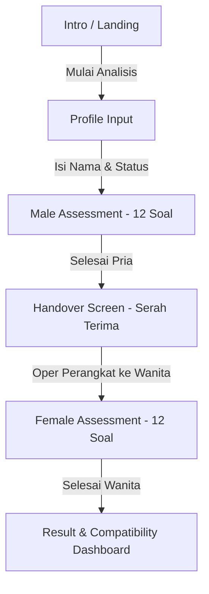

# Product Requirement Document (PRD): VisiRelasi

**Nama Produk:** VisiRelasi  
**Versi:** 0.1.0 (MVP)  
**Status:** In Development / Active  
**Tech Stack:** React 18, TypeScript, Vite, Tailwind CSS, Lucide React  
**Arsitektur:** Client-side Single Page Application (SPA), State Management via React Context (`QuizContext`)  

---

## 1. Executive Summary & Product Overview
**VisiRelasi** adalah aplikasi asesmen psikometri dan pemetaan keselarasan relasi interaktif dua arah (*double-blind assessment*) yang dirancang khusus untuk pasangan kekasih maupun calon pengantin (*pre-marital couples*). 

Aplikasi ini memfasilitasi pasangan untuk mengeksplorasi keselarasan pandangan hidup, nilai-nilai fundamental, serta preferensi rumah tangga pada **5 Pilar Utama Relasi**. Bukan sekadar memberikan skor kecocokan umum, VisiRelasi menghasilkan analisis komprehensif (*Compatibility & Deep Talk Report*) yang dilengkapi dengan panduan diskusi konstruktif (*Deep Talk Protocol*) untuk membantu pasangan mendiskusikan topik sensitif secara bijak, transparan, dan terarah.

---

## 2. Problem Statement & Target Audience

### Problem Statement
1. **Topik Krusial Terabaikan:** Banyak pasangan sebelum menikah enggan/takut membicarakan topik finansial, peran rumah tangga, parenting, dan batasan keluarga besar karena khawatir memicu pertengkaran.
2. **Komunikasi Reaktif:** Diskusi sering kali baru terjadi saat masalah sudah terlanjur meletus, bukan diantisipasi sejak awal.
3. **Bias Pengisian Bersama:** Mengisi kuisioner bersamaan dalam satu layar terbuka sering memicu bias jawaban karena salah satu pihak merasa sungkan atau terpengaruh jawaban pasangannya.

### Target Audience
- **Pasangan Pre-Marital:** Pasangan usia 20–35 tahun yang berencana melangkah ke jenjang pernikahan.
- **Pasangan Fase Serius:** Pasangan yang ingin melakukan validasi dan pemetaan hubungan jangka panjang secara objektif.

---

## 3. Product Flow & User Journey

VisiRelasi mengadopsi alur terstruktur 6 tahap (*6-step linear flow*) yang diatur melalui state engine `QuizStep`:

### Rincian Tahapan Alur Pengguna:
1. **Intro (`intro`):** Penjelasan value proposition VisiRelasi & CTA "Mulai Analisis".
2. **Profile Input (`profile`):** Memasukkan data awal (Nama Pasangan Pria, Nama Pasangan Wanita, Durasi Hubungan, Status Hubungan).
3. **Male Quiz (`male_quiz`):** Pihak pria menjawab 12 pertanyaan psikologis terstruktur (opsi berlabel perspektif pria).
4. **Handover (`handover`):** Layar transisi handover antar pasangan. Jawaban pria dikunci rapat demi privasi agar pasangan wanita menjawab secara murni tanpa bias (*double-blind protocol*).
5. **Female Quiz (`female_quiz`):** Pihak wanita menjawab 12 pertanyaan yang sama dengan opsi berlabel perspektif wanita.
6. **Result Dashboard (`result`):** Algoritma menghitung skor keselarasan dan menampilkan dashboard analisis lengkap, matriks kekuatan vs titik kritis, serta protokol deep talk.

---

## 4. Feature Specifications & Functional Requirements

### FR-1: Kuisioner Psikometri Double-Blind
- **Isolasi Jawaban:** Jawaban pihak pria disimpan dalam state memori dan tidak ditampilkan sampai wanita selesai mengisi.
- **Perspektif Ganda Tiap Opsi:** Setiap pertanyaan memiliki opsi `a, b, c, d` dengan konteks redaksional yang disesuaikan untuk Pria (`maleLabel`) dan Wanita (`femaleLabel`).

### FR-2: Model 5 Pilar Keselarasan Relasi
Kuisioner membagi penilaian ke dalam 5 pilar fundamental:
1. **Finansial & Ambisi Karir (`financial`):** Pengelolaan keuangan, ambisi karir, dan skema pengeluaran bersama.
2. **Peran Rumah Tangga & Parenting (`domestic`):** Pembagian tugas domestik, pola asuh anak, dan relasi keluarga besar.
3. **Resolusi Konflik & Emosi (`conflict`):** Gaya komunikasi saat berselisih, pola de-eskalasi emosi, dan kompromi.
4. **Batasan Sosial & Privasi (`social`):** Batasan pertemanan lawan jenis, kebutuhan ruang sendiri (*me-time*), dan etika media sosial.
5. **Visi Jangka Panjang & Spiritualitas (`vision`):** Rencana hidup 5–10 tahun ke depan, prinsip spiritual, serta tujuan masa depan bersama.

### FR-3: Mesin Algoritma Skor & Matriks Kecocokan (`compatibilityEngine`)
- **Skema Penilaian Matriks Per Pertanyaan:**
  - *Exact Match* (Jawaban identik): 100% keselarasan.
  - *Complementary Match* (Jawaban saling melengkapi / kompromis): 50% – 75%.
  - *Divergent Match* (Jawaban bertolak belakang): 0% – 25% (diberi flag *Blindspot / Red Flag* jika skor pilar < 50%).
- **Klasifikasi Tier Keselarasan:**
  - `85% - 100%`: **Sangat Selaras (Harmonis)**
  - `70% - 84%`: **Selaras dengan Catatan**
  - `55% - 69%`: **Perlu Kompromi & Penyesuaian**
  - `< 55%`: **Potensi Konflik Tinggi (Butuh Perhatian Khusus)**

### FR-4: Dashboard Hasil & Deep Talk Protocol (`ReportDashboard`)
- **Score Hero Card:** Visualisasi persentase keselarasan total & ringkasan diagnosis status relasi.
- **5-Pillars Breakdown:** Diagram batang/indikator visual per pilar secara transparan.
- **Key Strengths vs. Blindspots:** Pemetaan langsung pilar terkuat vs titik paling rawan friksi.
- **Deep Talk Protocol:** Rekomendasi panduan percakapan dan pertanyaan pemantik diskusi berdasarkan jawaban yang berseberangan.
- **Export & Share Options:** Fitur cetak/salin ringkasan hasil untuk didiskusikan bersama.

---

## 5. Non-Functional Requirements (NFR)

- **Kinerja Client-Side Instan:** Seluruh komputasi skor dan evaluasi matriks dilakukan secara lokal di browser melalui modul TypeScript murni tanpa lag (< 50ms).
- **Privasi & Keamanan:** State jawaban disimpan secara in-memory (React Context), aman dari pencurian data pihak ketiga untuk MVP.
- **UI/UX Responsif:** Didesain dengan filosofi *mobile-first* menggunakan Tailwind CSS, touch-friendly untuk penggunaan langsung di satu smartphone secara bergantian.
- **Tone Empatis:** Bahasa yang digunakan bersifat netral, membangun (*constructive*), tidak menjustifikasi benar/salah (*non-judgmental*).

---

## 6. Roadmap Pengembangan Mendatang

| Fase | Fokus | Deliverables |
|---|---|---|
| **Fase 1 (Current)** | Core Assessment MVP | 12 Pertanyaan, 5 Pilar, Handover Mode, Report Dashboard |
| **Fase 2 (Short-Term)** | Persistensi & Ekspor PDF | Auto-save ke LocalStorage, Ekspor PDF bergaya dokumen resmi |
| **Fase 3 (Mid-Term)** | Multi-Device Pairing | Sinkronisasi via QR Code/Room Code untuk 2 perangkat berbeda |
| **Fase 4 (Long-Term)** | AI Relationship Coach | Rekomendasi saran dan panduan deep talk adaptif berbasis AI |
